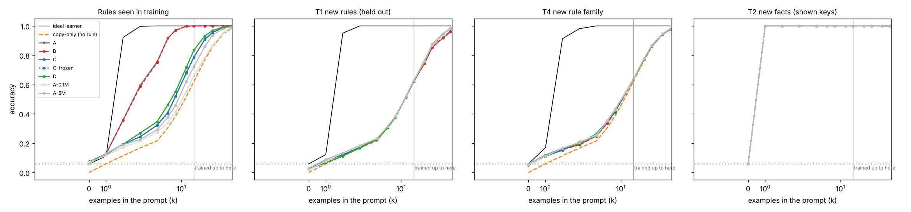

# 02 · Learn while prompted: a 20 MB model that learns new rules and facts from its prompt

**Goal:** show that a model of 20 MB or less can learn something new from the examples in its prompt, and keep improving when the prompt holds more examples than it ever trained on.
**Verdict:** **FAIL.** The models learned to copy answers they were shown, but none learned a new rule from examples, and test-time training added nothing. ✨ INTRIGUING: a 0.4 MB model recalls new facts perfectly from one example, even in prompts 4× longer than any it trained on. [Details](docs/results.md) · [Full tables](docs/tables.md) · [Explainer](EXPLAINER.md) · [Plan](https://claude.ai/artifact/QJmX6kJcpcrz43cT4kMQkh)

| # | Criterion (pre-registered) | Result | PASS/FAIL |
|---|---|---|---|
| C1 | ≤ 20 MB per model, ≤ 50 MB total, ≤ 10 min GPU training, ≤ 1 s to learn a prompt | 19 MB, 16 MB, timer read 11.5 min (6.8 of it an outside pause; real ≈ 4.7), 0.014 s | FAIL* |
| C2 | Learns new rules: ≥ 80% on held-out rules at k=8 | 38.7% (copying alone: 38.4%) | FAIL |
| C3 | Learns new facts: ≥ 90% recall at k=16, unseen keys at chance | 100%, unseen 6.2% | PASS |
| C4 | **Headline:** best of C/D at k=64 ≥ 80% of ideal and ≥ 15 pts over frozen A | 99% of ideal but +1.3 pts over A | FAIL |
| C5 | Learned updates beat naive updates by ≥ 10 pts | +0.2 pts | FAIL |

Controls passed: shuffled labels and an untrained model stayed at chance, and the base model learned (100% on training rules). \*C1 only failed because an outside pause was counted as training time; the verdict is FAIL either way.



**What I found that the abstracts don't tell you:** with only 204 training rules, the best-trained model memorised those rules (97% at k=8) instead of learning the algorithm, then fell back to pure copying on new rules. That fits the task-diversity threshold of [Raventós et al. 2023](https://arxiv.org/abs/2306.15063) (not tested directly here: rule diversity wasn't varied). Also, "% of ideal at long prompts" (C4) rewarded copying: always pre-register a copy-only baseline.

## What is tested

Every prompt is generated by code, so nothing is downloaded, and 25% of rules are held out of training.

| Task | In each prompt | Learning means |
|---|---|---|
| T1 new rules | a fresh rule y = (a·x + b) mod 17, as k examples; 25% of rules never appear in training | right answer for an input not shown |
| T2 new facts | a fresh random table of 32 key → value facts | recall a shown fact; unseen keys must stay at chance |
| T3 longer prompts | T1 and T2 with up to 64 examples; training used at most 16 | accuracy keeps rising past 16 |
| T4 new rule family | y = (a·x² + b) mod 17, never trained on | exploratory, no threshold |

| Arm | How it learns while prompted | Size |
|---|---|---|
| A | frozen transformer: attention does the learning (in-context learning) | 1.0M params |
| B | A plus 2 plain SGD steps on the prompt's own examples (leave-one-out), lr picked on training rules | same weights as A |
| C | same as B, but trained with the update inside the loop (meta-learning), with learned step sizes | 1.0M |
| C-frozen | C's weights without the update (ablation) | 1.0M |
| D | fast-weight memory: each layer writes every example into a matrix with the delta rule, with learned write and forget gates | 1.0M |
| A-0.1M, A-5M | size sweep of A | 0.1M, 4.8M (19 MB) |

Controls: a brute-force **ideal learner** (ceiling), **shuffled labels** and an **untrained model** (must stay at chance), and **unseen-key questions** (must stay at chance, catches answer leaks).

Test-time training only updates a small per-prompt adapter (rank 8, last two blocks). The shared weights never change, so one user's prompt can't affect another's.

## Run it

```bash
pip install -r ../../requirements.txt
python -m pytest -q          # code tests, seconds, never trains
python run.py --quick        # smoke check with tiny UNTRAINED models (~5 s, CPU is fine)

# On an NVIDIA GPU only (training refuses to run on CPU):
python train.py              # all 5 arms in ONE process taking turns on the GPU, 5 min total
python run.py                # evaluate every arm, print the PASS/FAIL table, write results/
python demo.py --arm A --facts   # watch arm A learn new facts, one example at a time
python demo.py --teach "1:5 2:8 3:11"   # teach it your own examples
```

Checkpoints are saved in fp16 (about 16 MB for all five) to `ckpt/`, which git ignores; the `exp02-checkpoints-v1` GitHub release holds them once published.

## Files

| File | What it does |
|---|---|
| `tasks.py` | prompt generators and the ideal learner |
| `models.py` | the transformer and fast-weight memory models, with the per-prompt adapter |
| `ttt.py` | leave-one-out test-time training |
| `arms.py` | arm definitions, checkpoint save/load |
| `train.py`, `gpu_tasks.py` | GPU training (one process, prompts generated on the GPU, pauses while system RAM is above 92%) |
| `run.py`, `criteria.py`, `plots.py` | evaluation, pre-registered criteria, plots |
| `demo.py` | interactive demo |
| `test_learn.py` | 19 code tests: masks, leaks, gradients, budgets, verdict logic |

## Background

A 4-minute probe before the plan (a 104K-param model, on CPU before the GPU-only rule) scored 4% → 44% on unseen rules (chance 5.9%; copying alone would give 38%, so it too was mostly copying), and plain test-time SGD made it worse (35% → 24% at k=6). C5 tests whether learning to be updated fixes that. Related work: [Garg et al. 2022](https://arxiv.org/abs/2208.01066), [Akyürek et al. 2024](https://arxiv.org/abs/2411.07279), [Sun et al. 2024](https://arxiv.org/abs/2407.04620), [Titans](https://arxiv.org/abs/2501.00663), [MAML](https://arxiv.org/abs/1703.03400).

## Limitations

Synthetic tasks over 17-32 symbols, not language. One seed per arm, and the five arms share one 5-minute GPU budget (the main arms get about 1-2 minutes each). Arm D gets no test-time optimizer, so C vs D compares two kinds of update rule, not equal compute.
