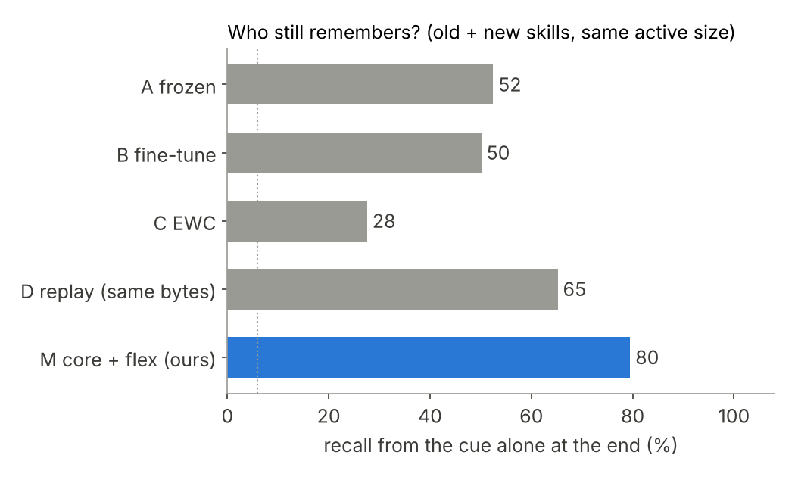

# 05 · Core + flexible weights

**Goal:** can a fixed-size tiny model keep a stable core, pick up new skills in a small flexible ring, harden the ones that keep coming back, and archive (never lose) the ones it replaces, so it remembers better than fine-tuning or replay at the same size?

**Verdict: FAIL** (4 of 5) · ✨ INTRIGUING: the archive does the remembering. Any slot cache with an archive keeps as much as unlimited slots, and one ring that evicts by use-strength matches the two tiers · details: [EXPLAINER.md](EXPLAINER.md) · [results/results.md](results/results.md)

| # | Criterion (pre-registered in [criteria.py](criteria.py)) | Threshold | Result |
|---|---|---|---|
| C1 | Budget | active ≤ 20 MB, kept ≤ 20 MB, ≤ 10 GPU min, update ≤ 50 ms, lookup ≤ 100 µs, RAM ≤ 2 GB | **PASS**: 0.5 MB active, 0.9 MB kept, 1.9 GPU min, 43 ms, 3.3 µs, 1.6 GB |
| C2 | Remembers old + new skills at the end (headline) | ≥ fine-tune + 30 pts **and** ≥ replay (same bytes) + 5 pts | **FAIL**: 79.5 vs 50.1 (+29.4) and 65.2 (+14.3) |
| C3 | Learns a new skill fast (after its first 6 examples) | ≥ fine-tune − 5 pts | **PASS**: 35.4 vs 37.3 (−1.9) |
| C4 | Recovers archived skills with no new examples | ≥ 90% of last recall; no-archive ablation ≤ 50% | **PASS**: 100% (194 returns) vs 16% |
| C5 | Hardening protects frequent skills through bursts of one-offs | ≥ one-ring LRU cache + 10 pts | **PASS**: 77.3 vs 47.4 (+30) |

C2 missed by 0.6 points, which is 4 seed standard deviations (σ = 0.15), so the FAIL stands. All controls stayed at chance (shuffled cues 5.3%, never-seen 5.6%, frozen on new skills 5.1%); routing errors 0%.



**What the ablations say:** without the archive, stream recall falls from 59 to 23 points. A one-ring LRU cache with an archive retains just as much (79.8). Slot count barely matters with an archive (9, 18, 36 or unlimited: about 59). Hardening keeps frequent skills loaded through bursts (+30 over LRU), but a single ring that evicts by use-strength does it too (80.3 vs 77.3). No learner found the rule: on inputs not yet shown, every arm stayed at or below chance, so a one-off caps at 6/17 = 35%.

Validity gate (else INCONCLUSIVE): both pretrained nets ≥ 90% on known skills; shuffled cues, never-seen skills, the frozen net on new skills and shuffled labels (on unseen inputs) all ≤ chance + 5 (chance 5.9%); wrong-slot routing ≤ 2%.

## How it works

- **Skill:** a cue (a random point on a 64-d sphere, arriving with noise each time) bound to a hidden rule `y = (a·x + b) mod 17`. 208 rules are known before the stream, 64 are new.
- **Stream (per seed):** 224 episodes of 6 worked examples. 8 frequent skills ×12, 24 occasional ×4, 32 one-offs in 4 bursts of 8. Recall is tested from the cue alone, with no examples.
- **M, core + flex (ours):** a frozen 186K-param core plus 18 slots (each a key, a code and a rank-4 change that plug into the core): a flexible ring of 6 that learns fast, and a core ring of 12 that a skill joins after 3 visits and that learns 10× slower. Routing is a nearest-key lookup. When a ring is full, the weakest slot goes to the archive and comes back when its cue does. The active size never grows.
- **Baselines at the same active parameter count (249K):** A frozen · B fine-tune · C online EWC · D replay with as many bytes as M's largest possible archive.
- **Ablations:** no archive · one ring with LRU or strength eviction · harden at first sight · unlimited slots · half and double the slots. Hyperparameters are tuned on a separate validation stream.

## Run

```bash
python train.py            # GPU only, ~5 min: pretrain, tune, every arm on 3 seeds -> results/raw/
python run.py              # score: verdict table, results/results.md, plots (no GPU needed)
python run.py --quick      # < 30 s CPU plumbing check (tiny run, not a result)
python run.py --clean      # caches + quick results (--all also deletes ckpt/)
python -m pytest -q        # correctness tests
```
